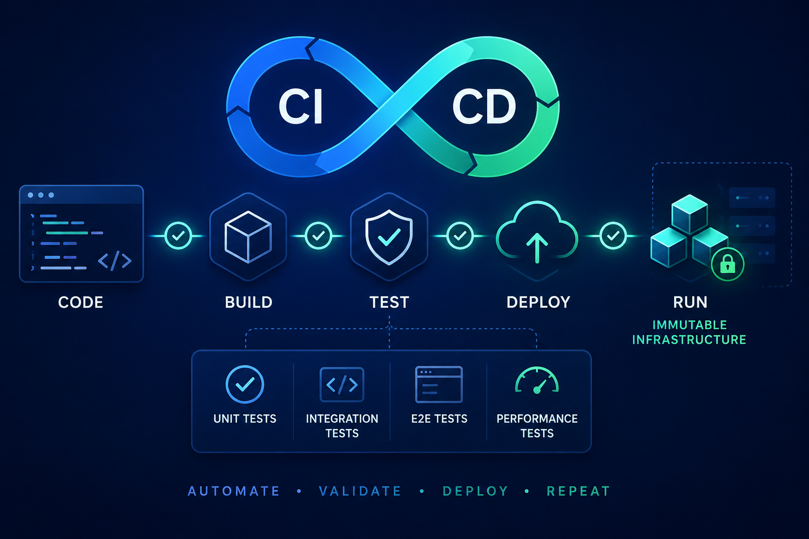

+++
title = "Automate CI/CD: From Check-in to Immutable, Tested Releases"
date = "2026-06-14T09:00:00+00:00"
tags = ["ci","cd","devops","immutable-infrastructure","testing","automation"]
categories = ["devops","automation"]
description = "End-to-end continuous integration and delivery: build, package, test, and deploy immutable artifacts with automated approvals and continuous testing."
banner = "img/banners/automate-cicd.png"
keywords = ["ci","cd","devops","immutable-infrastructure","testing","automation","continuous integration","continuous deployment","automation", "phoenix devops"]
+++

Continuous integration and continuous delivery (CI/CD) are more than pipelines — they're the operational backbone that turns code changes into reliable, repeatable, and auditable production artifacts. When every code check-in triggers a fully automated workflow that builds, packages, tests, and releases immutable artifacts, teams gain velocity without sacrificing safety.

<!--more-->

## 1. Start at Check-in: Fast, Reliable CI

Every CI workflow should begin at the moment a developer pushes code. Key activities at this stage:

- Build: Compile or bake a container / VM image from source, ensuring the exact same artifact can be reproduced from the same commit.
- Unit & component tests: Run fast, deterministic tests that validate business logic and surface regressions quickly.
- Static analysis & security scans: Enforce linting, dependency checks, and SAST rules early to fail fast on low-level issues.

The CI server must produce a single immutable artifact — a container image, a machine image, or a versioned package — that will be the sole input to downstream stages.

## 2. Immutable Infrastructure: Build from Code, Deploy the Artifact

Immutable infrastructure means you never mutate running servers: instead, you replace them with new instances built from code. Benefits:

- Reproducibility: Images are built from the same source and configuration every time.
- Consistency: Environments are identical across staging and production.
- Simplified rollbacks: Reverting is replacing with a prior known-good image.

Implement immutable infrastructure with Infrastructure-as-Code (IaC) and image baking:

- Use IaC (Terraform, Pulumi, CloudFormation) to declare networking, compute, and platform services.
- Bake golden images (or build container images) in CI to include OS hardening, runtime dependencies, and a signed artifact manifest.
- Store artifacts in an artifact registry (container registry, artifact repository) with immutable tags and immutability policies.

## 3. Automate Release Approval: Policy, Tests, and Gates

Manual approvals slow teams. Automate gating using policy and test outcomes:

- Policy checks: Ensure license, vulnerability, and compliance policies are satisfied before promotion.
- QA test automation: Run integration and system tests in an environment that mirrors production.
- Signed attestations: Attach verifiable signatures to artifacts that passed required checks.

When conditions are met, the pipeline can auto-promote artifacts to downstream environments — or require a minimal human approval step for high-risk releases.

## 4. Continuous Deployment Across the Stack

A mature pipeline continuously deploys the artifact and required infrastructure changes across all layers:

- Infrastructure: Apply IaC changes atomically so environment changes are tracked alongside the artifact.
- Database: Use migrations that are backward-compatible and build feature toggles to avoid coupling deploys with schema changes.
- Middle-tier & front-end: Deploy the same immutable artifact to staging and push to production with strategies like blue/green or canary.

Key techniques:

- Orchestrated rollouts: Canary and phased deployments reduce blast radius and allow monitoring to drive promotion.
- Transactional updates: Coordinate infrastructure and application changes to avoid partial failures (e.g., feature flag toggles, dual-write patterns during migration windows).

## 5. Test Automation on Deployed Artifacts

Testing must follow the artifact into the environment it's meant to run in. Recommended automated tests:

- End-to-end functional tests: Verify user journeys against real endpoints.
- API contract and schema tests: Prevent regressions when downstream services change.
- Security tests: Dynamic application security testing (DAST), dependency vulnerability scans, secrets detection, and runtime instrumentation for suspicious behavior.
- Resilience and chaos tests: Validate graceful degradation and recovery from failures.
- Real-user input testing: Fuzzing and property-based tests against public inputs simulate malformed or unexpected payloads.
- Load and performance tests: Run scaled tests (or synthetic traffic) to ensure autoscaling and resource limits behave under real-world loads.

### Mobile QA and Test Automation

Mobile applications introduce specific quality and automation challenges that must be addressed in a CI/CD pipeline:

- Device diversity: Automate tests across a matrix of OS versions, screen sizes, and hardware capabilities using simulators, emulators, and real-device clouds.
- Network conditions: Validate app experience under varying network types, latency, packet loss, and offline/resume behavior.
- UI/UX regression tests: Use automated UI testing tools for platform-specific flows, gestures, and accessibility checks.
- App lifecycle testing: Automate background/foreground transitions, push notification handling, deep links, and session restoration.
- Dependency and privacy review: Automate checks for third-party SDKs, permission usage, and runtime privacy-sensitive APIs.
- Binary signing and store readiness: Integrate signing, notarization, and app-store packaging into CI so the mobile build is deployable without manual intervention.

Recommended mobile automation layers:

- Build and unit tests in CI: Compile native apps, run unit tests, and capture coverage for shared business logic.
- Integration tests for backend APIs: Verify mobile client-server contracts against staging services.
- UI automation on device farms: Run end-to-end app tests with tools such as Appium, Espresso, XCUITest, or Detox.
- Security and mobile-specific static scans: Check for insecure data storage, improper certificate validation, weak crypto, and unsafe inter-process communication.

Automate these mobile QA steps as part of the gated promotion pipeline. If a mobile artifact fails on any device profile, it should be blocked from promotion and returned for developer remediation.

Automate these tests as part of a gated promotion pipeline. Only artifacts that pass the full suite should be signed and eligible for auto-release.

## 6. Observability, Metrics & Automated Rollback

Continuous deployment must be paired with robust observability:

- Telemetry: Collect traces, logs, and metrics for key business and system signals.
- Alerting & SLOs: Drive deployment decisions with SLO-based monitoring and automated rollback when thresholds are breached.
- Automated rollback: When canaries show regressions, the deployment system should automatically revert traffic to the previous artifact and open a remediation workflow.

## 7. Best Practices

- Treat pipelines as code: Keep your CI/CD configs, policies, and IaC under version control and code review.
- Single source of truth: Use the same artifact across staging and production to prevent environment drift.
- Shift-left security: Run static and dependency checks in CI before artifacts are baked.
- Secure pipelines: Limit credentials, use short-lived tokens, and sign artifacts and manifests.
- Make deployments reversible: Prefer immutable artifacts and blue/green or canary patterns.

## Conclusion

Automating CI/CD from check-in to production — with immutable artifacts, declarative infrastructure, and automated testing and approval — gives teams the ability to move fast and stay safe. Start by producing a single immutable artifact per commit, bake your infra from code, gate promotions with automated policy and tests, and deploy with observability-driven rollouts. The result is a trustworthy delivery pipeline that scales with your organization.

